# dsh-meeting：多智能体冲突协商插件

**中文** | [English](README.en.md)

**基于 A2A 的多智能体协商：排会、约周末团建、投票点奶茶。**

## 解决什么问题

约一个三个人的会，常见的过程是：在群里问「周四谁有空」，等每个人翻日历回复，发现没有交集，再私聊某个人「你午休能不能挪一下」，最后有人去订会议室、发邀请。约周末团建、团奶茶更麻烦：时间要凑，口味要问，还有人乳糖不耐。

dsh-meeting 是一个 DeepSeek Harness（dsh）插件，把这些来回沟通交给每个人自己的 AI 助理。每个人在自己的电脑上跑一个 dsh 助理，同一局域网里的助理会自动发现彼此，用 A2A 协议互相发报文，替各自的主人谈时间、谈口味：

- **每个助理只代表一个人**，只读写本机主人的日程、偏好和原始记录（聊天记录、外卖记录之类）。
- **助理之间直接谈**：发请求、回可用时段、求交集、提方案、确认，全部走 A2A 报文，不需要中心服务器。
- **保护隐私**：对外只说「可用 / 勉强 / 需要本人点头」，不说具体原因。比如对方只知道你 12:00–13:30「需本人点头」，不知道那是午休。
- **本人拍板**：遇到只有本人能决定的事（比如占午休），助理不会替你答应，而是在你的手机页弹出卡片，由你点「同意 / 不同意」。

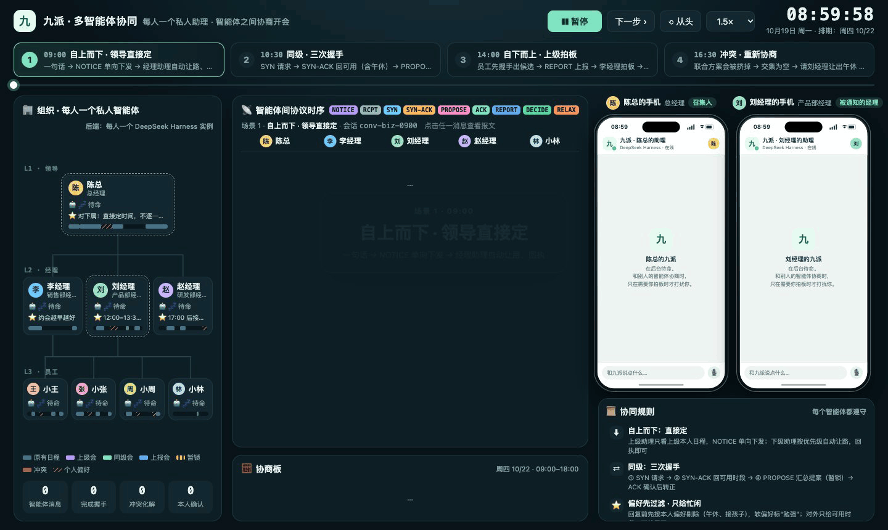

> [!WARNING]
> **没有任何鉴权，只能在可信的局域网里用。** 插件会在局域网上监听 4500（手机页 / 节点）和 41500（A2A）端口。同一网络里的任何人都能打开你的手机页、给你的助理发报文、给你发消息。团队码只用来防止不同团队串台，不是密码。不要在公共 Wi‑Fi 或公网上用。

---

## 安装

前提：已经装好 DeepSeek Harness 网页版或桌面版，并且这个 profile 的**默认模型可用**（已经登录 DeepSeek 账号，或者配好了 API Key）。助理用的就是这个默认模型。

1. 打开 DSH 网页，左侧栏 **插件 → 添加插件**，粘贴下面的安装包地址，点安装：

   ```
   https://github.com/maximehu97/dsh-meeting/releases/latest/download/dsh-meeting.tgz
   ```

2. 安装完点 **启用**。
3. **重启 dsh web**（桌面版就是重启应用）。左侧栏会出现「📅 约会议」，点开就是本机的手机页。也可以在浏览器里直接打开 `http://127.0.0.1:4500/`；同一 Wi‑Fi 下的真手机可以打开 `http://<这台电脑的 IP>:4500/`。
4. 第一次打开时选「我是谁」。
5. macOS 第一次弹出「允许 node 接受传入网络连接」时，点 **允许**。

用命令行安装也可以：

```bash
dsh plugin --profile web add https://github.com/maximehu97/dsh-meeting/releases/latest/download/dsh-meeting.tgz
```

**更新**：在插件页先 **卸载** 旧版，再按上面的步骤重新安装，然后重启。本人数据保存在 `~/.dsh-meeting`，卸载插件不会删除它。

插件只往 profile 里加三样东西：本机节点 `meeting`、助理 preset `meeting`、入站 A2A `meeting-a2a`，不会改动这个 profile 的模型和会话设置。

> 不用 DSH 界面、想单独起一个 profile 的话，可以在 [Releases](https://github.com/maximehu97/dsh-meeting/releases) 下载 `dsh-meeting-kit-<版本>.zip`，解压后运行 `./install.sh`，再运行 `./start.sh`。

### 两台电脑试一试

| 剧本 | 电脑 A（发起人说） | 电脑 B | 看点 |
|---|---|---|---|
| 同级排会 | 李经理：「约刘经理周四开个一小时的双十一联合方案会，越早越好。」 | 刘经理 | SYN → SYN-ACK → PROPOSE → 本人确认 → CONFIRM，订会议室 |
| 上级通知 | 陈总：「周四下午三点，三位经理开个经营分析会，一小时。」 | 刘经理 | NOTICE，刘经理的助理发现和 1on1 撞了，按偏好顺延 |
| 团建 + 奶茶 | 小美：「这周末拉项目组的人去奥森骑行野餐……顺便团一波奶茶」 | 小雨（还可以加阿杰、老周、Kiki） | 提取档案 → 求交 → RELAX → 投票 → 平票拍板 → 下单 |

## 核心功能

### 1. A2A 多智能体协商排会

对自己的助理说一句「约刘经理、赵经理开个双十一联合方案会，周四，一小时，越早越好」，助理会：

1. 向对方助理发 **SYN**（请求可用时段）；
2. 收到各自的 **SYN-ACK**，在本机算交集；
3. 最早的时段要占刘经理的午休，就发 **RELAX**（松绑请求），刘经理的手机上弹出卡片，由他本人决定；
4. 刘经理选择保留午休，助理改提 **PROPOSE** 14:00–15:00，对方 **ACK**，助理订会议室、发 **CONFIRM**，三个人的日历同时写入。

| 发起方：约好了 | 被问方：本人决定要不要让出午休 | 日程页 |
|---|---|---|
| 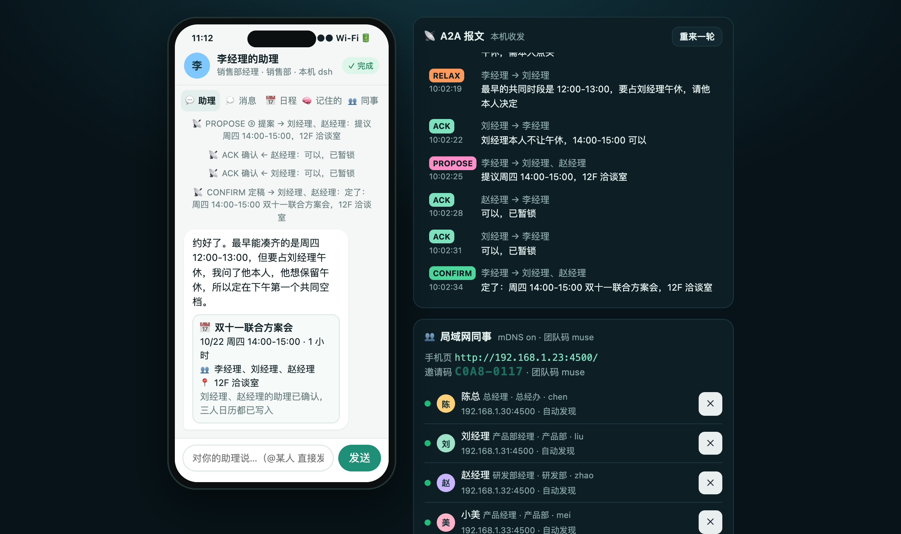 | 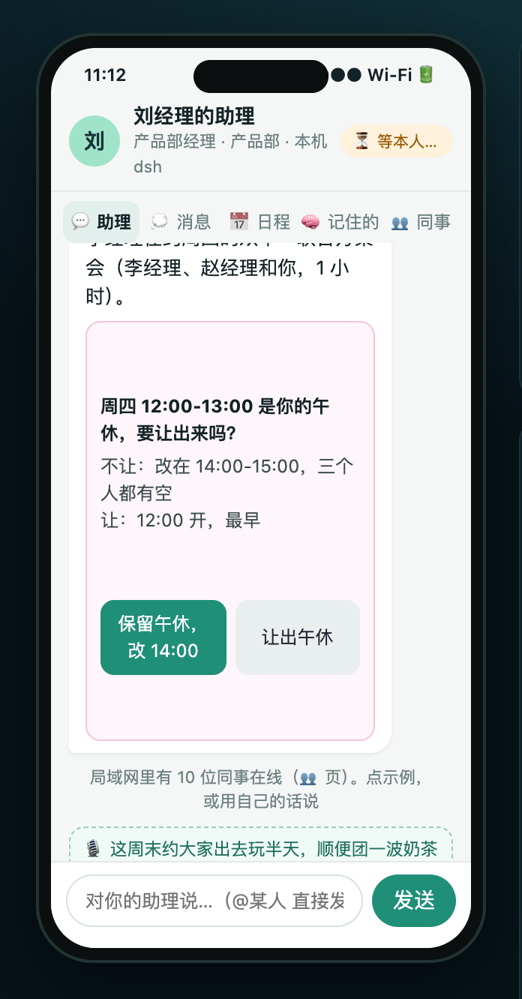 | 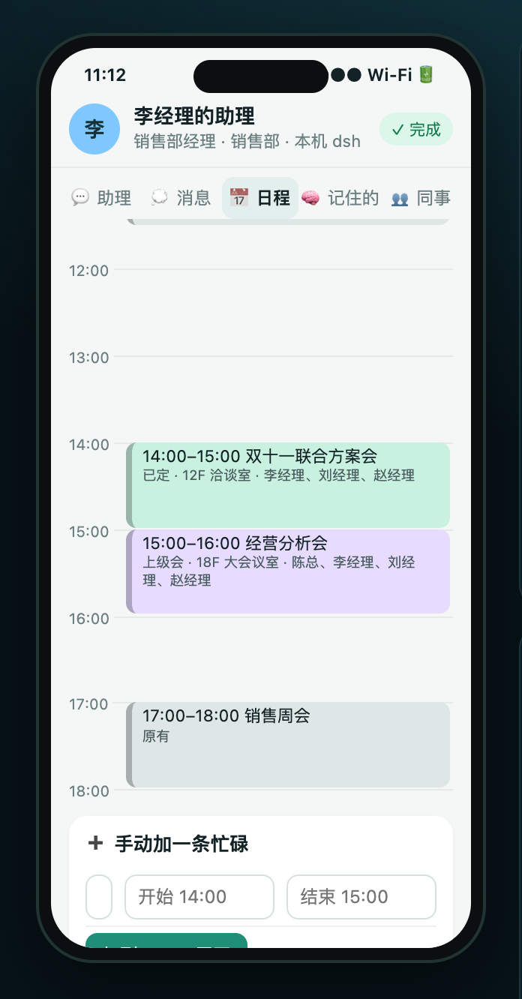 |

除了同级之间的三次握手，还支持上级直接通知会议（**NOTICE**），下属的助理按主人的偏好处理冲突，比如把 1on1 顺延。

### 2. 约周末团建

小美说「这周末拉项目组的人去奥森骑行野餐，三个小时左右」。助理把请求同时发给阿杰、小雨、老周、Kiki 的助理。整个过程是个性化、自动化的：

- **每个人都有自己的隐藏日程**。助理第一次被问到时，先读本人的原始记录（家庭群、备忘录、12306 订单、体检报告……），自己整理出「走不开 / 勉强 / 本人点头可让」的时段和口味忌口，存进「🧠 记住的」。
- **对外只给忙闲，不给原因**。老周的助理只回「周日不行」，不会说他要全家回外婆家。
- **助理自动求交，找代价最小的让步**。老周周日全天不在，阿杰周日中午赶火车，Kiki 周日下午上课，只能放周六；周六下午撞上小雨的上线值班，助理从她的聊天记录里知道同事阿强说过可以代盯，于是只问她本人一句。
- 最后定下的周六 13:00–16:00 正好在老周送孩子上游泳课之后、回家做晚饭之前，每个人的日历自动写入。

| 小雨的助理：只在需要本人让步时才问 | 老周的「记住的」：从原始记录里提取的档案 | 老周的日程：团建避开了他的隐藏安排 |
|---|---|---|
| 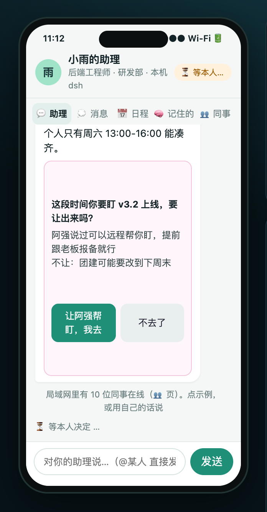 | 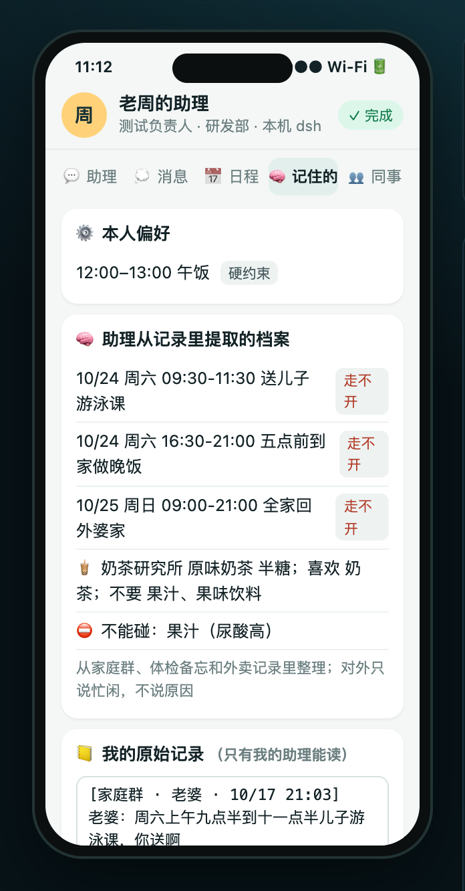 | 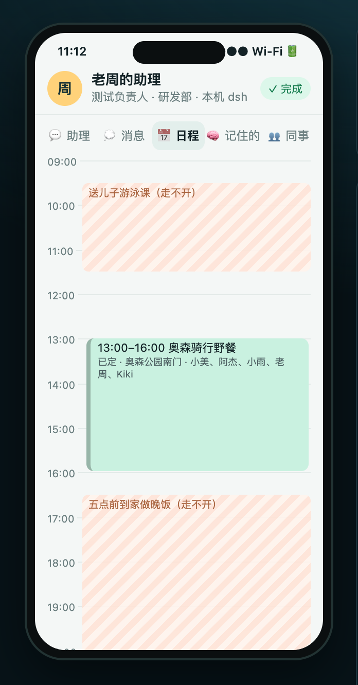 |

### 3. 投票点奶茶

时间定下来以后，发起方的助理发 **VOTE**，每个助理按主人记录里的口味和忌口回 **BALLOT**：两家店各打 0–3 分，有忌口可以一票否决，并选好自己那杯。阿杰乳糖不耐，小雨要控糖，老周不能喝果汁，Kiki 坚果过敏又不爱水果茶，小美不喝奶茶。结果两家都是 9 分，平票交给小美拍板。下单时每个人都拿到符合自己忌口的那杯，5 杯刚好免配送费。

| 计票、平票由发起人拍板、下单 | 团单 |
|---|---|
| 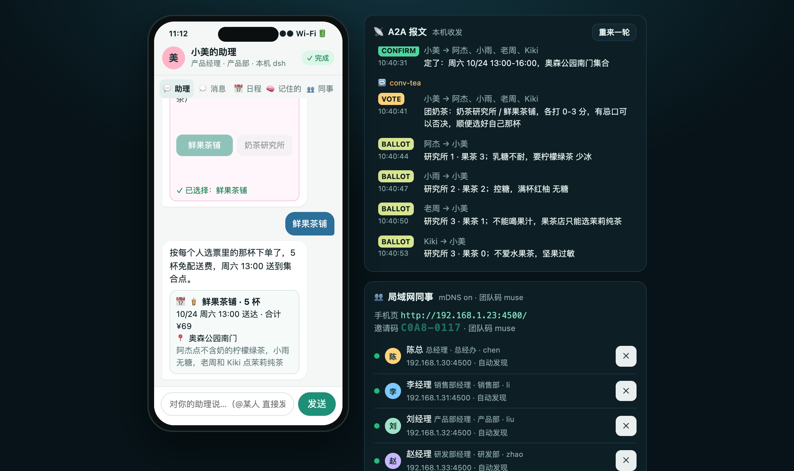 | 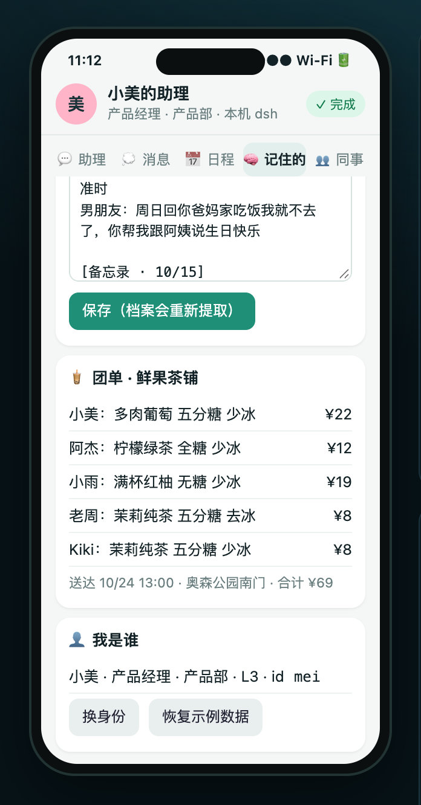 |

### 4. 群聊和 @ 提及

人和人之间也能直接说话，消息不经过助理：

- 在助理页输入「@小美 周五记得带伞」，这句话会直接发给小美；「@小美@阿杰 …」会同时发给两个人。输入 @ 时会弹出选人列表。
- 💭 消息页可以私聊，也可以建群、拉人、退群。在群里 @ 谁，谁就会收到提醒。
- 对方不在线时，消息先存在本机发件箱，等对方上线后自动补发。
- 也可以让助理代劳，比如「帮我跟刘经理说一声我晚到十分钟」「群里大家在聊什么」。

| 消息列表：私聊、群聊和未读 | 群聊里 @ 某人 |
|---|---|
| 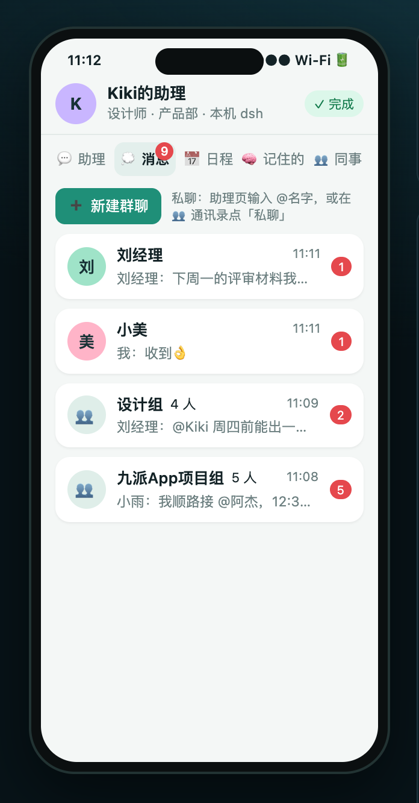 | 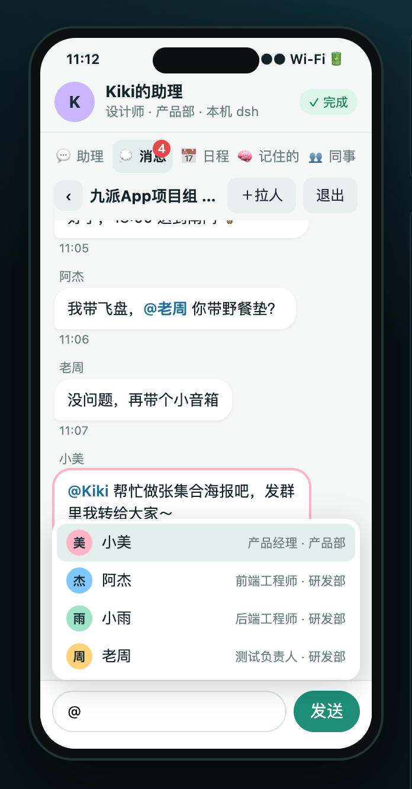 |

### 5. 13 人公司通讯录

插件自带一家 13 人的示例公司，装好就能演示：

| 部门 | 成员 |
|---|---|
| 总经办 | 陈总 |
| 销售部 | 李经理、小王、小张、小周 |
| 产品部 | 刘经理、小林、小美、Kiki |
| 研发部 | 赵经理、阿杰、小雨、老周 |

小美、Kiki、阿杰、小雨、老周还同属跨部门的「九派App项目组」。每个人都有自己的工作日日程、偏好和原始记录（奶茶口味、忌口、周末安排）。第一次打开手机页时选「我是谁」：可以选公司里的一个角色（灰色的已经被局域网里别的电脑用了），也可以自己填名字、职位和部门。之后在「🧠 记住的」里点「换身份」可以重新选。

| 公司通讯录：按部门列出，显示谁在线 | 选一个角色，或者自己填 |
|---|---|
| 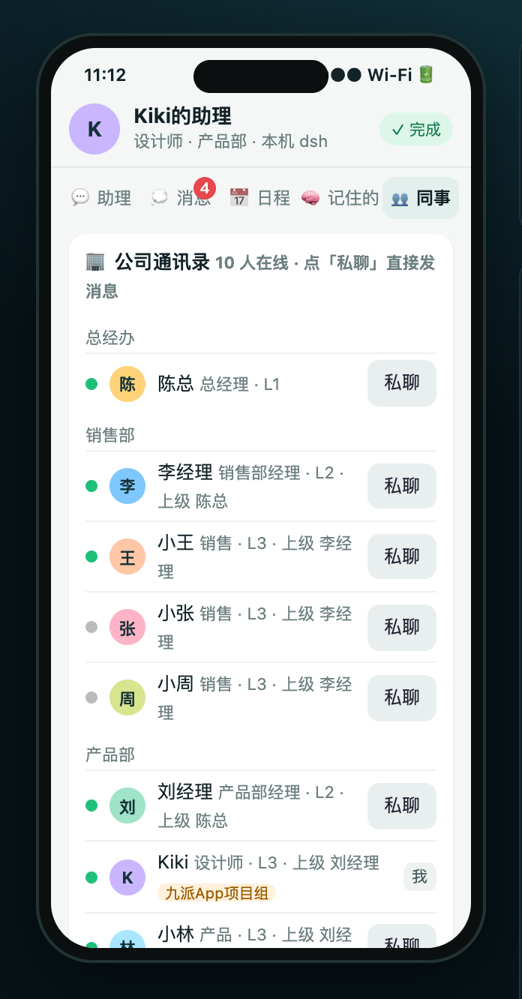 | 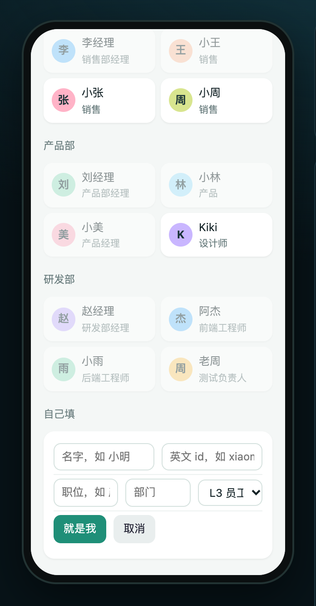 |

### 6. 局域网 mDNS 自动发现

同一 Wi‑Fi 下的同事几秒内就会出现在 👥 页（Bonjour 服务类型 `_dshmeet._tcp`，只有团队码相同的节点才会互相识别，每 15 秒心跳一次）。如果路由器屏蔽组播（很多公司或酒店 Wi‑Fi、手机热点会这样），就在 👥 页手动填对方的 IP、`IP:端口` 或邀请码。只需要一方添加，双方都会记住。

## 架构

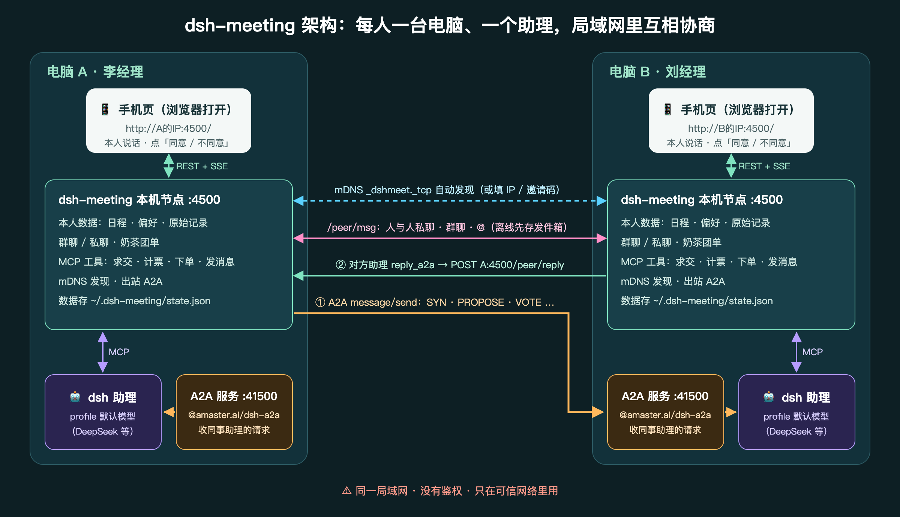

每台电脑上的 dsh 进程里有三个部分，都由本插件的 bundle patch 插入：

| 组件 | 作用 |
|---|---|
| **本机节点** `dsh-meeting` :4500 | 保存本人数据（日程、偏好、原始记录、消息、团单）；提供手机页（REST + SSE）；提供给助理用的 MCP 工具（求交、计票、下单、发消息）；负责 mDNS 发现和出站 A2A |
| **助理** preset `meeting` | 用 profile 的默认模型。工具只有本机节点的 MCP 工具，没有 bash 或文件工具 |
| **入站 A2A** `@amaster.ai/dsh-a2a` :41500 | 接收同事助理发来的 A2A 请求，交给本机助理处理 |

一次协商的报文流：

1. 助理调用 `send_a2a`，本机节点向对方电脑的 :41500 发 A2A JSON-RPC（`message/send` 非阻塞，再用 `tasks/get` 轮询）；
2. 对方助理处理完后调用 `reply_a2a`，对方节点把结构化回复 POST 到发起方节点的 `/peer/reply`；
3. 人与人的私聊、群聊走节点之间的 `/peer/msg`，不经过助理。

本人确认有两道保护：`ask_owner` 会在本人手机页弹卡片并一直等待；`grant_exemption`（同意占用本人保护的时段）只有在本人 30 分钟内点过同意时才会生效。

## 端口与防火墙

| 端口 | 用途 | 需要对局域网开放 |
|---|---|---|
| 4500/TCP | 本机节点：手机页、节点之间的 `/peer/*`；`/mcp` 只接受 127.0.0.1 | 是 |
| 41500/TCP | 入站 A2A（@amaster.ai/dsh-a2a） | 是 |
| 5353/UDP | mDNS 组播（自动发现） | 是（不通也能用，手动添加 IP 即可） |

- **macOS**：第一次启动时弹出「允许 node 接受传入网络连接」，点允许。如果开了「阻止所有传入连接」或第三方防火墙，需要放行 node。
- **Linux（ufw）**：`sudo ufw allow 4500,41500/tcp && sudo ufw allow 5353/udp`
- 端口被占用时可以改端口。dsh 的 patch 会整份替换配置，所以节点端口、preset 里的 MCP 地址和 A2A 端口三处要一起改，可以用 `lib/patch.mjs` 生成叠加层；独立安装包里直接用 `DSH_MEETING_PORT=4600 ./start.sh`。

## 安全说明

> [!CAUTION]
> - **没有鉴权、没有加密**：手机页、`/peer/*` 和 A2A 端口对整个局域网开放。任何能连到你电脑的人都能看你的日程、以你的身份发消息、给你的助理发请求。
> - **只在可信的局域网里用**，比如办公室内网或家里的 Wi‑Fi。不要在公共 Wi‑Fi 上用，也不要做端口转发或暴露到公网。
> - 团队码只用来区分不同团队，不是密码。
> - 示例数据都是虚构的。如果换成你自己的真实日程和聊天记录，请记住上面几条。
> - 不用的时候，在插件页停用插件。

## 数据与重置

- 数据保存在 `~/.dsh-meeting/state.json`，包括日程、档案、对话和消息。
- 手机页右上角的「重来一轮」会清空对话和报文，日程保留。
- 🧠 页的「恢复示例数据」会回到示例的初始状态，「换身份」可以重新选人。

## 开发

```bash
node scripts/build.mjs   # 生成 lib/seeds.json 和 cordis.patch.yml，打包 dist/ 下的 tgz 和独立安装包 zip
```

| 路径 | 作用 |
|---|---|
| `lib/index.js` | cordis 插件入口（配置 schema、启停本机节点） |
| `lib/client.js` | 浏览器端：DSH 侧栏「约会议」和主区页面 |
| `lib/node.mjs` | 本机节点：状态、工具实现、出站 A2A、mDNS 和手动发现、HTTP |
| `lib/mcp.mjs` | MCP 工具清单和 Streamable HTTP 处理 |
| `lib/engine.mjs` | 带日期的忙闲计算、求交、松绑、计票 |
| `lib/prompt.mjs` | 助理提示词 |
| `web/` | 手机页 |
| `kit/` | 独立安装包里的 install / start / stop 脚本 |
| `docs/images/` | README 截图（用示例数据在本地渲染手机页得到）和演示动图 |

`package.json` 里的 `dsh.bundle` 声明了插件要插入的 patch（`cordis.patch.yml`）。

## License

MIT
